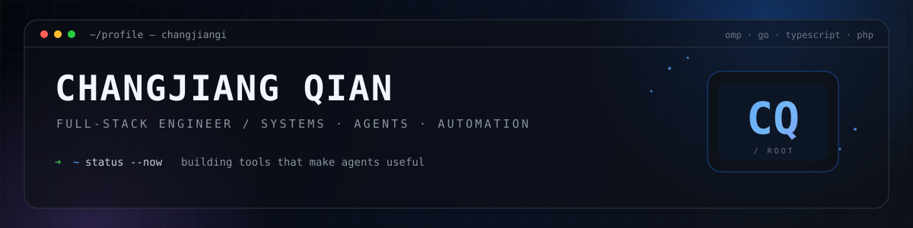

  

### `> whoami`

Full-stack engineer working across **Go, TypeScript, PHP, and Vue**.
I build backend systems, automation, and tooling for agents — with a soft spot for reverse engineering and developer experience.

---

## `$ cat stack.txt`

---

## `$ ls projects/`

| Project | What it is | Stack |
| --- | --- | --- |
| **[omp-purge](https://github.com/changjiangi/omp-purge)** | Session-scoped system-prompt switch for omp | `TypeScript` |
| **[rea](https://github.com/changjiangi/rea)** | Reverse engineering with agents, from app behavior to native binaries | `TypeScript` |
| **[gaowang](https://github.com/changjiangi/gaowang)** | Go backend / systems project | `Go` |
| **[videoflow](https://github.com/changjiangi/videoflow)** | Video workflow tooling | `TypeScript` |

---

## `$ git log --graph`

  
  

  

  

---

  <code>while (alive) { build(); learn(); repeat(); }</code>

